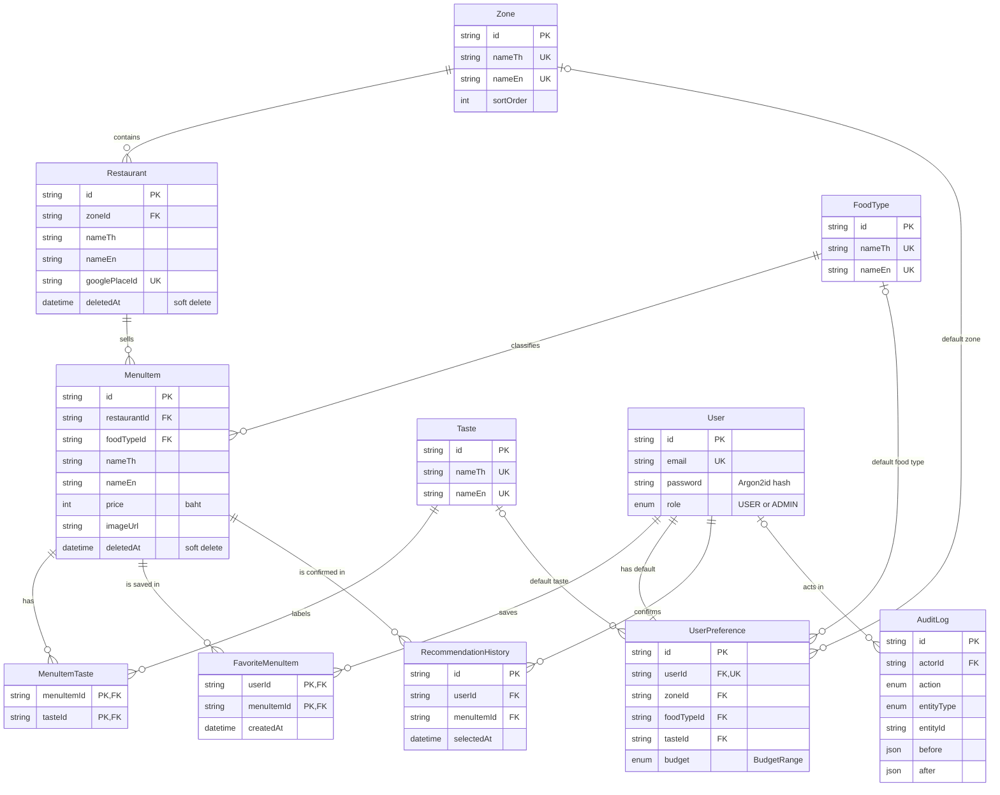

# Sequence and ER diagrams (D5, D6)

**Status:** Draft, 2026-11-17, pending human approval. These two diagrams are drawn from the code as it is on `main`, not from a new design. The approved diagrams D1 Context, D2 Use Case, D3 Architecture and D4 Activity stay in [`diagrams.md`](diagrams.md).

Sources:

- D5: `src/api/src/modules/recommendations/recommendations.service.ts` (`recommend`, `selectItems`), `gemini-shortlist.adapter.ts`, `recommendations.repository.ts`, `recommendations.suggestion.ts`.
- D6: `src/api/prisma/schema.prisma`; field-level detail in [`../03-implementation/data-model.md`](../03-implementation/data-model.md).

---

## D5 — Sequence: get a three-dish shortlist (core workflow, F1–F3, F19–F22)

```mermaid
sequenceDiagram
  autonumber
  actor Seeker as Meal Seeker
  participant Web as Web app (React)
  participant API as API POST /api/recommendations
  participant Svc as Recommendations service
  participant DB as PostgreSQL (Prisma)
  participant AI as Gemini (AI shortlist provider)

  Seeker->>Web: choose budget, taste, food type, zone
  Web->>API: conditions, rejected IDs, displayed IDs, count = 3
  API->>API: validate body (Zod) and rate limit
  API->>Svc: recommend(input)
  Svc->>DB: check taste / food type / zone IDs exist
  Svc->>DB: findCandidates(conditions, excluded IDs)
  DB-->>Svc: eligible dishes (have a photo, not deleted)

  alt no eligible dish
    Svc->>DB: findSuggestionPool(excluded IDs)
    Svc->>Svc: findSuggestion: smallest condition change (F22)
    Svc->>DB: findCandidates(adjusted conditions)
  end

  alt count = 3 and more than 3 eligible dishes
    Svc->>Svc: selectDiverseCandidates: pool of up to 6, mixed restaurants
    Svc->>AI: conditions + up to 6 candidates (5 s timeout)
    alt valid answer: known IDs, no duplicates, different restaurants
      AI-->>Svc: 3 menu item IDs + Thai reason each
      Svc->>Svc: mark each dish source = AI
    else error, timeout or invalid answer
      Svc->>Svc: fallback: selectDiverseCandidates(3)
    end
  else replacement (count = 1) or 3 or fewer eligible
    Svc->>Svc: selectDiverseCandidates (no AI call)
  end

  Svc-->>API: items (+ adjustment if conditions were changed)
  API-->>Web: 200 JSON
  Web-->>Seeker: up to 3 cards with reasons; reject, undo, edit or confirm
```

Notes:

- The AI never sees the whole catalog. It only chooses among candidates the rules already accepted, so every shortlist meets the user's conditions whether or not AI was used.
- A replacement after a rejection (`count = 1`) never calls the AI and never weakens the conditions.

---

## D6 — ER diagram (database, `schema.prisma`)



Delete rules (from `schema.prisma`): deleting a restaurant cascades to its menu items; deleting a user cascades to favourites, preference and history, and sets `AuditLog.actorId` to null; zones, food types and tastes in use cannot be deleted (`Restrict`).
