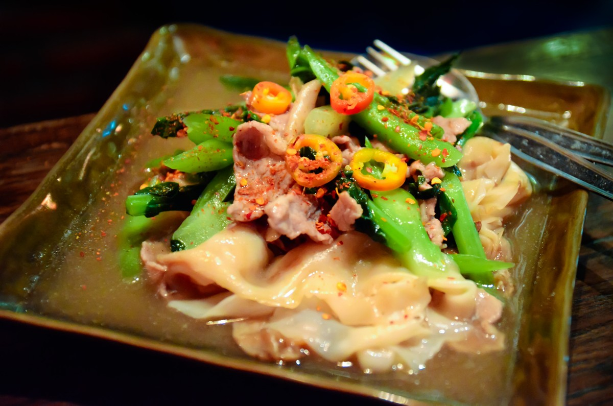
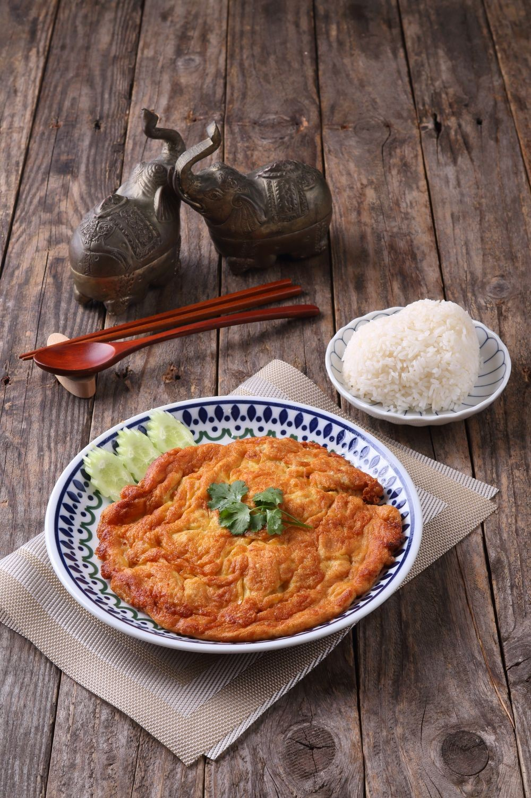

# Food photo matching review — 2026-10-24

Requested by the project owner: identify missing food photos, search multiple free stock sources, retrieve candidates, match them to menu names, and check accuracy.

## Result

- Baseline: 92 of 222 visible menu items had neither a local image nor a stock URL; these use 89 distinct photo keys.
- Search: 141 Openverse queries, returning 630 candidate records, including duplicates, across Flickr and Wikimedia Commons. Additional web searches checked Pexels, Pixabay, Unsplash and StockSnap. These counts are search results, not 630 visually approved photos.
- Accepted and added to the source catalog: **ราดหน้า — เชฟต๋อย**. After catalog generation, 131 of 222 items have images and **91 remain without images**.
- Near match, not applied: **ข้าวไข่เจียว (2 ฟอง)**. Pexels has a Thai omelette with white rice, but rice is on a separate plate and the number of eggs cannot be established.
- The other 90 items have no verified complete match in this search. This does not establish that no suitable free photo exists anywhere.
- No database seed, remote database update or deployment was run. The application source catalog and its generated seed/credits were updated; a running database does not change automatically.

## Accepted photo

- Menu: ราดหน้า, เชฟต๋อย; ID `c31vx0y7s508hemkbfuuqrwum`; photo key `rad-na`.
- [Original source: Kuai-tiao rat na mu](https://commons.wikimedia.org/w/index.php?curid=12262426), creator **Takeaway**.
- [CC BY-SA 3.0](https://creativecommons.org/licenses/by-sa/3.0/). Creator, original page and license are preserved in the photo pool, generated credits and web credit data.
- Visual check: broad rice noodles, sliced pork, Chinese kale and thick gravy are visible. No identifiable people or watermark are visible. Original source description independently identifies pork and Chinese broccoli.
- Matches the menu's pork option. This is an illustrative stock photo; it does not verify the restaurant's actual serving, portion size or recipe. No visual adaptations were made to the image linked by the application. The local review preview is resized and has metadata removed.
- `rad-na-license.json` records only the source metadata needed to verify the dish, creator and license; location metadata is excluded.

## Near match held back

[Pexels photo 35049884](https://www.pexels.com/photo/traditional-thai-omelette-with-rice-on-rustic-table-35049884/) by UNDO KIM, under the [Pexels License](https://www.pexels.com/license/). Downloaded and visually inspected. Dish identity is consistent, but serving arrangement differs and two eggs cannot be confirmed; not added to the application.

## Accuracy criteria and exclusions

Acceptance requires the named main ingredients, cooking method, defining sauce and rice/noodle format to agree with the menu description. Stock imagery cannot prove the restaurant's recipe, serving size, cut of meat or seasoning merely from color.

Examples rejected during review:

- Chicken kofta search returned kofta curry and a rice platter with grilled chicken pieces, not the specified grilled chicken kofta meal.
- Spicy mayo chicken search returned a fish donburi; the protein is wrong.
- Nori chicken candidate had mayonnaise and a salad-heavy presentation; nori seasoning could not be established.
- Thai suki candidates showed a communal hot pot or raw ingredients; they do not represent the single-serving glass-noodle soups or dry suki dishes.
- Crispy pork curry candidates displayed photographer watermarks and did not show the specified rice meal. Not selected.
- Tomato egg / mapo tofu / morning glory photos cannot represent the two-dish pork combination meals when the fried pork component is absent.
- Generic grilled meat, noodles or salad is not evidence of mala, Korean sauce, Snow White sauce, chili paste, onsen egg or the required meat cut.
- The menu “ทีรามิสุสลัด” is described in the catalog as a customizable protein salad, not tiramisu dessert. Generic dessert imagery is inappropriate, and a particular protein combination cannot be inferred.

Original provider pages and specific licenses take precedence over search tags. Free search pages can contain paid or sponsored results; none were selected. No photos from delivery platforms, restaurant listings or recipe blogs were reused.

## Files

- `review.html`: readable review with photos and all 92 menu rows.
- `menu-review.csv`: full missing-menu inventory and per-menu outcome, query count, reason and source.
- `menu-review.json`: the same inventory with menu IDs, names and descriptions.
- `search-results.json`: queries and candidate titles, creators, image URLs and licenses; candidates are **unapproved unless explicitly accepted above**.
- `rad-na-license.json`: primary-source verification of the accepted photo.

Previous source pools, generated catalog/credit/checklist files and verification report were copied to `evidence/archive/20261024-before-stock-photo-research/` before updates. Application feature code, requirements and plan were unchanged. Build/test/lint outcomes are recorded in `docs/verification.md`.
